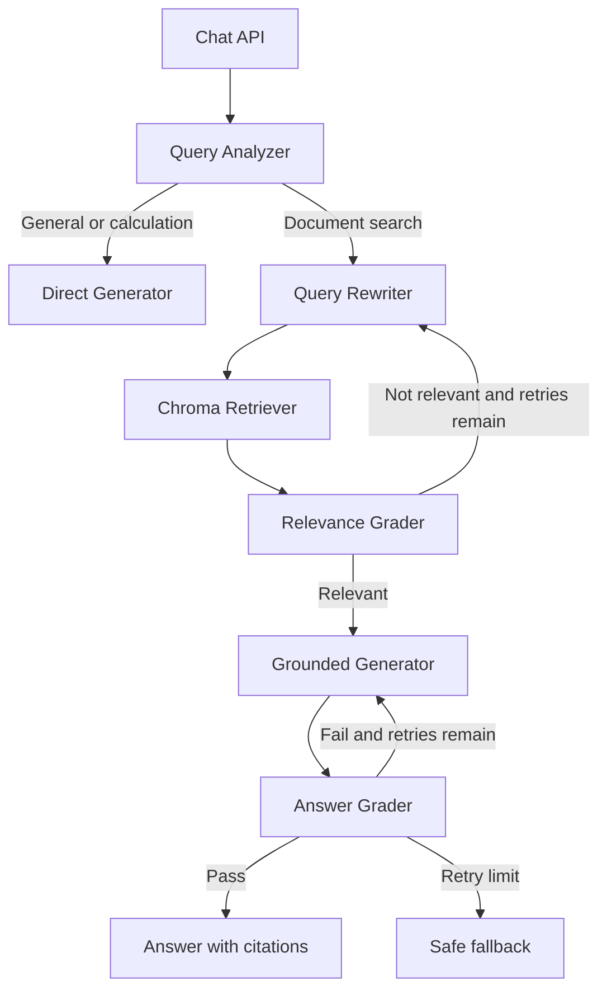

# Agentic RAG Document Assistant

A modular document assistant built with FastAPI, LangGraph, LangChain, Ollama, ChromaDB, React, Vite, and Tailwind CSS. It classifies each question, chooses direct or document-grounded answering, retries weak retrieval, grades evidence, and returns source metadata without exposing chain-of-thought.

## Architecture



## Requirements

- Python 3.11+ (3.12 is supported)
- Node.js 18+
- Ollama running locally, with `ollama pull llama3.2:3b` and `ollama pull nomic-embed-text`

## Setup on Windows

```powershell
py -3.11 -m venv .venv
.\.venv\Scripts\Activate.ps1
pip install -r requirements.txt
Copy-Item .env.example .env
ollama pull llama3.2:3b
ollama pull nomic-embed-text
```

Start the API:

```powershell
uvicorn backend.app.main:app --reload
```

Start the frontend in a second terminal:

```powershell
cd frontend
npm install
npm run dev
```

The API is available at `http://localhost:8000`, Swagger docs at `/docs`, and the frontend at `http://localhost:5173`.

## Tests

```powershell
.\.venv\Scripts\python.exe -m pytest -q
cd frontend
npm run build
```

Tests use fake stores and deterministic agent paths where possible. Ollama is only needed for a live chat or production ingestion embedding.

## API

- `POST /api/documents/upload` — upload PDF, TXT, or DOCX
- `GET /api/documents` — list indexed documents
- `DELETE /api/documents/{document_id}` — remove document vectors
- `POST /api/chat` — ask a question with optional `conversation_id`
- `GET /api/chat/history?conversation_id=...` — retrieve conversation messages
- `GET /api/health` — service health

